# agent-memory

**One shared memory for every AI coding agent on every machine you own — and a diary of what you did each day.**

[中文](README.md)

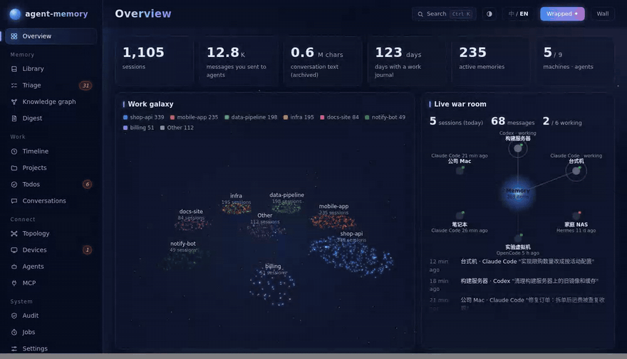

You use Claude Code on the desktop, Codex on the laptop, Hermes / OpenClaw on a server, WorkBuddy now and then… each agent remembers on its own, and switching tools or machines means starting from zero. agent-memory is a small self-hosted service that ties them together:

- **Shared memory** — each agent's native memory files (Claude Code memory, Hermes `USER.md`, WorkBuddy `MEMORY.md`, …) sync to a hub; every agent can query and write through MCP tools; a digest (preferences, project status, what you've been doing lately) is injected into each tool's instruction file.
- **Conversation archive + work journal** — every agent's conversations (user and assistant text only, secrets redacted) are uploaded incrementally and kept long-term; a cheap model writes one line per session per day ("what got done"). Ask any agent on any machine "what did I do last Thursday?" or "when did we ship that deploy?".
- **Console** — open the hub in a browser and you get one sidebar console (`/console`): an overview (a rotating "work galaxy", a live war room, things that need attention); a memory library (search, filter, edit, retire, version history), a triage queue (candidates, likely duplicates, stale status, memory gaps, cold memories), a knowledge graph and a digest page (preview the digest each agent receives, pin or exclude entries); a timeline (work calendar, per-day swimlanes for every machine and agent, punch card, milestones), projects (with read-only share links), todos and a searchable conversation archive (select a passage and save it as a memory); a live topology (devices, gateway, hub, storage, worker, with read/write traffic and event pulses, filterable by project, collapsible by device group, with a 24-hour replay), devices (read-only, hidden projects, groups, join codes), agent status and MCP (tool switches, call counts, latency and failure rate); audit, job status and settings. `Ctrl/Cmd+K` searches everything and can "ask your memories". Light and dark themes, Chinese and English interface. There is also an auto-cruising wall display (`/wall`, with the live topology as one of its scenes) and a year-in-review (`/w`).
- **Zero dependencies** — hub and device agent are single Node.js files (Node ≥ 18), no database; data is a git repo with one markdown file per memory.

| | | |
|---|---|---|
| [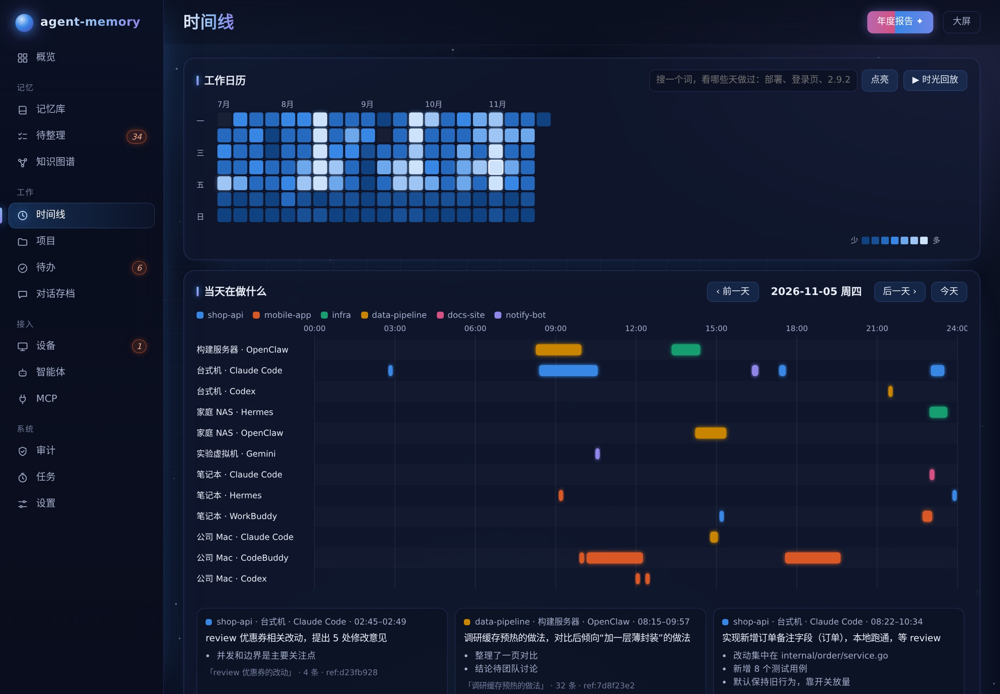](docs/screenshots/timeline.jpg) | [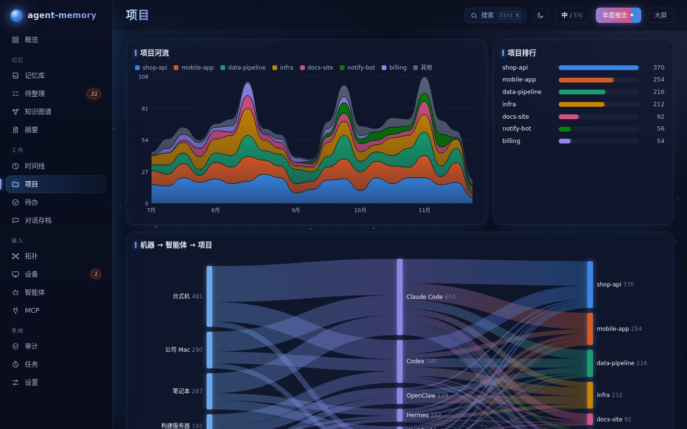](docs/screenshots/projects.jpg) | [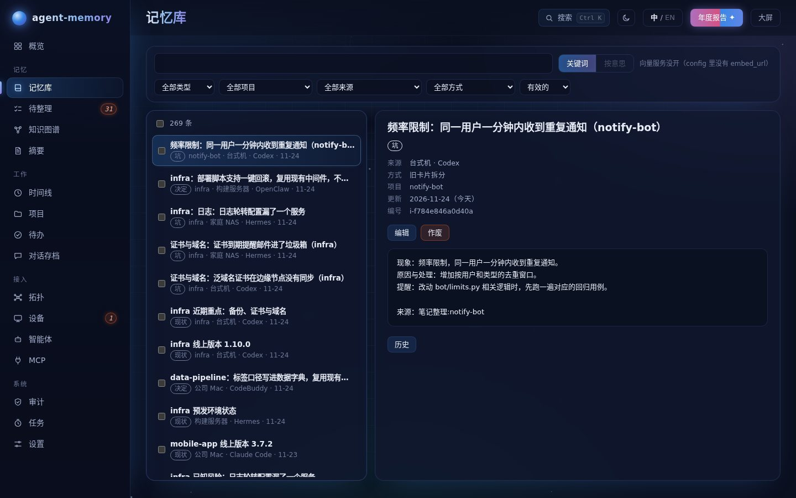](docs/screenshots/memory.jpg) |
| Timeline: work calendar and per-day swimlanes | Projects: river chart and machine → agent → project flow | Memory library: filter, search, details and history on the right |
| [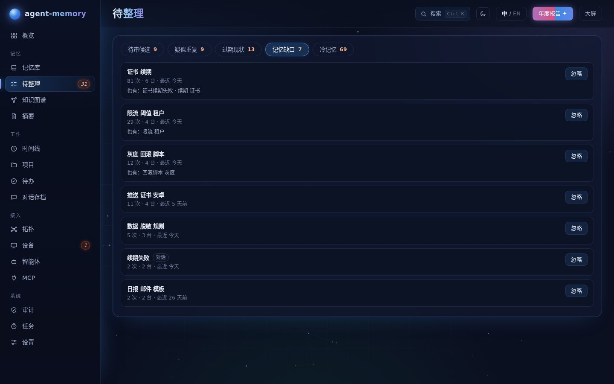](docs/screenshots/triage.jpg) | [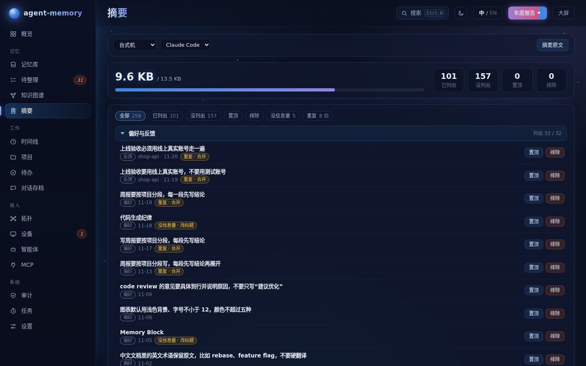](docs/screenshots/digest.jpg) | [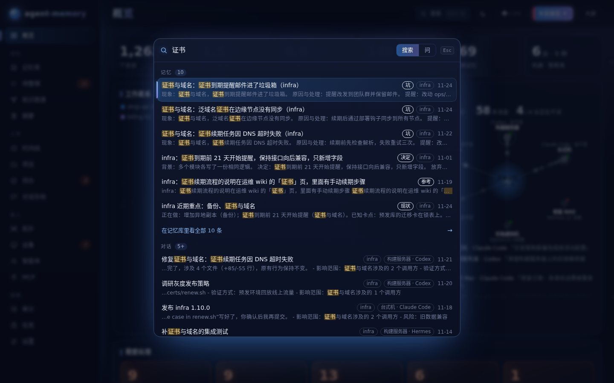](docs/screenshots/search.jpg) |
| Triage: memory gaps (searched, found nothing) and cold memories | Digest: budget use, pin/exclude, low-information and duplicate flags | `Ctrl+K`: search memories, conversations, projects, devices and pages — or ask |
| [](docs/screenshots/devices.jpg) | [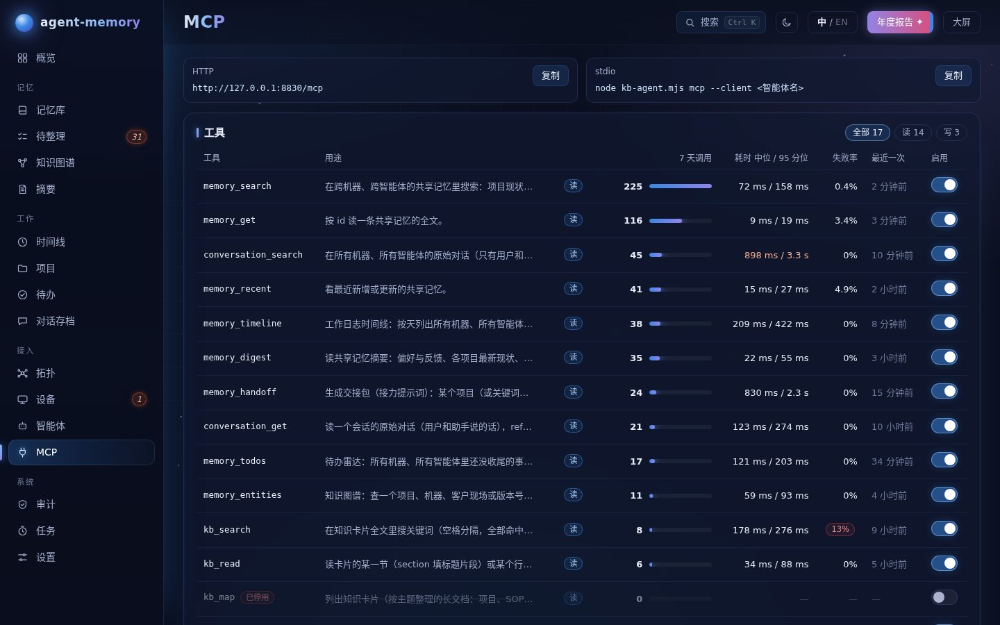](docs/screenshots/mcp.jpg) | [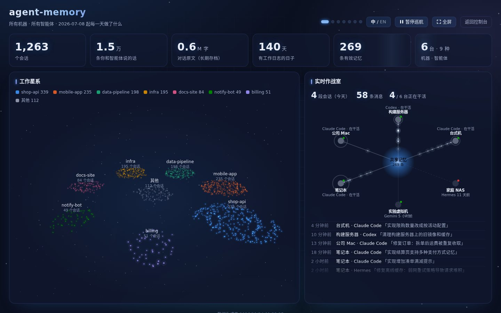](docs/screenshots/wall.jpg) |
| Devices: groups, sync state, read-only, hidden projects | MCP: tool switches, 7-day calls, latency and failure rate | Wall: auto-cruising, made for hanging on a wall |
| [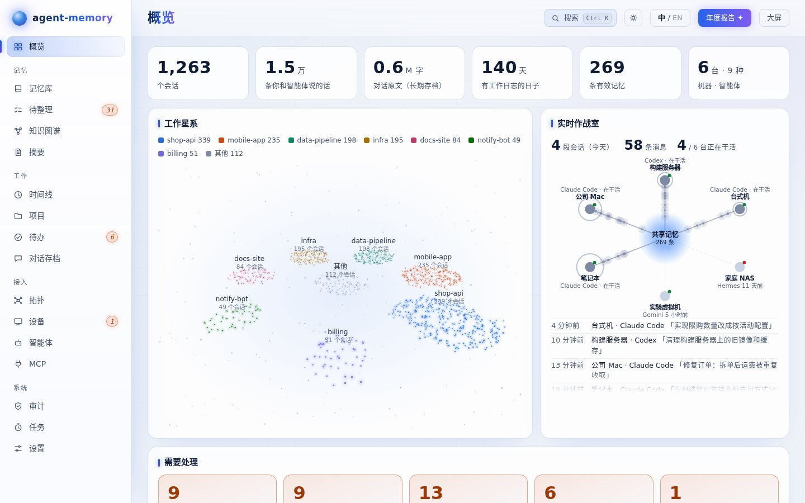](docs/screenshots/overview-light.jpg) | [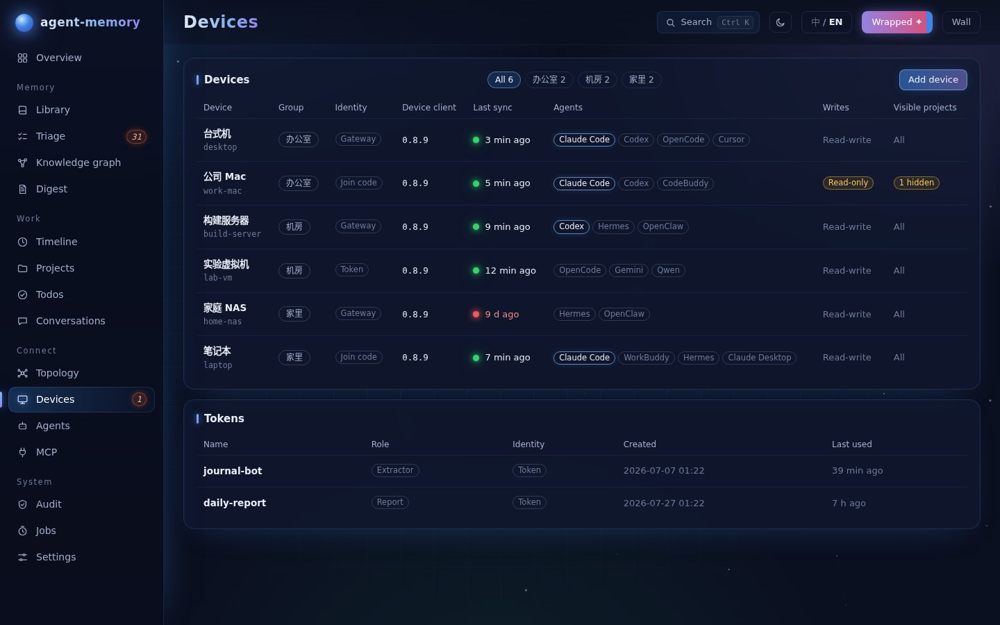](docs/screenshots/devices-en.jpg) | [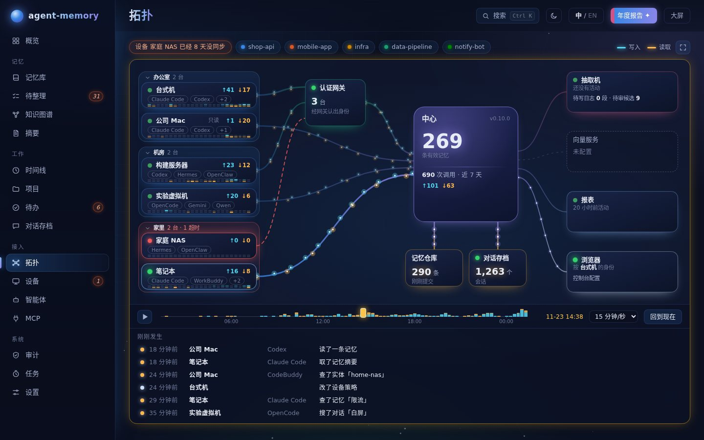](docs/screenshots/topology-replay.jpg) |
| Light theme (follows the system by default) | English interface (`中 / EN` in the top bar) | Topology replay: scrub the timeline to see links and events at that moment |

> Screenshots use the fictional data from `scripts/demo-data.mjs`.

> The author runs it daily across 8 machines and 7 agents. Code favors "works and easy to change"; comments are in Chinese.

## Worth knowing about the console

- **Search and ask** — press `Ctrl+K` (`⌘K` on Mac) anywhere to search memories, conversations, projects, devices and pages; Tab switches to "ask": relevant memories and conversation snippets are sent to any OpenAI-compatible chat endpoint and the answer carries `[1]`-style citations that jump to the source. Configure `ask_url` (`…/v1` or a full `…/chat/completions` URL), `ask_model` and `ask_key` under Settings → Ask; the key is write-only; without configuration "ask" says so. Ask is limited to 10 per minute per viewer and audited as `console:ask` (first 80 characters of the question); conversation snippets are redacted before they leave the hub.
- **Usage insights** — usage records carry hit counts, latency and errors. Triage adds **Memory gaps** (queries searched in the last 30 days that found nothing, near-duplicate wordings merged, can be ignored) and **Cold memories** (active memories nobody has read for a long time, always stating the date counting started, and only "still collecting data" until enough days have accumulated). The MCP page shows per-tool 7-day median and p95 latency and failure rate.
- **Memory tools** — a memory's "History" lists every version with time, author and diff, and lets you restore any version (restoring adds a new version; native-synced memories are excluded). Select text in the conversation archive and click "Save as memory" to store it with a provenance line. The Digest page lets you pin or exclude entries (`state/digest-rules.json`) and flags low-information and duplicate titles.
- **Access control and sharing** — when a device has `hide_projects`, the console and `/browse/*` show that device nothing about those projects (memories, work logs, conversations, todos, project names) and recompute totals; such a device cannot edit any device's hide list. On the Projects page, a project's timeline or handoff pack can become a read-only `/s/<token>` link valid for 1, 7 or 30 days, revocable, containing work-log summaries only (no conversation text); only the token hash is stored (see [docs/share-links.md](docs/share-links.md)). Links still resolve only inside your own network; to share beyond it you need a reverse proxy that forwards `/s/` only.
- **Theme and language** — the icon in the top bar cycles follow-system / light / dark, and `中 / EN` switches the interface language (both remembered in the browser). English comes from a translator running in the browser; **the hub's API still returns its messages in Chinese**; your own data is never translated. The wall, the annual report and the review page stay dark.
- **Fast first load** — static files and API responses of 1 KB or more are compressed per `Accept-Encoding`; the console's stylesheets and scripts are merged into content-hashed bundles on the server (long-lived caching) and the first-screen data comes in one request, so opening the topology page takes three requests after the html.

## Supported agents

Claude Code, Codex, WorkBuddy / WorkBuddy AI, CodeBuddy, Hermes, OpenClaw, OpenCode, Gemini CLI, Qwen Code (memory sync and/or conversation capture), plus Cursor, Windsurf and Claude Desktop (MCP only). `setup` detects what's installed and wires it up; MCP servers you disabled stay disabled.

## MCP tools

- Memory: `memory_search` (keyword + semantic), `memory_get`, `memory_remember`, `memory_update`, `memory_retire`, `memory_recent`, `memory_digest`
- Timeline: `memory_timeline`, `conversation_search`, `conversation_get`
- Handoff: `memory_handoff` (a ready-to-paste briefing for a project), `memory_todos` (unfinished work), `memory_entities` (relations between projects, machines, sites, versions)
- Cards (optional read-only long docs): `kb_map`, `kb_search`, `kb_sections`, `kb_read`

## Layout


[](docs/screenshots/topology.jpg)

<sub>The live topology in the console: on a device link, cyan dots are writes and amber dots are reads (density and thickness follow the last 24 hours); each device shows its read/write counts and a 24-cell heartbeat bar, and every new event in the strip below sends a pulse along its link; stale ones turn red, and components that are not configured are drawn dashed. The heartbeat bar has writes on the top row and reads below; the timeline between the canvas and the event band replays the last 24 hours; devices of one group share a plate and can collapse into a summary node.</sub>

```
agent/kb-agent.mjs   device agent: sync memory, upload conversations, write digests, stdio MCP proxy, self-update
hub/                 hub: server.mjs (HTTP + MCP), convlog (archive/journal), extras (handoff/todos/graph/semantic…), admin.mjs (console admin API under /console/api), console.html + console*.css/js (console), wall.html (wall display), wrapped.html (year in review)
worker/              journal.mjs / extract.mjs — run nightly on any machine with Codex CLI
gateway/am-gate.py   optional identity gateway (Tailscale names / libvirt VM names → zero-touch enrollment)
gateway/am-embed.py  optional local embedding service (fastembed + bge-small-zh) for semantic search
deploy/, scripts/    systemd examples, daily/weekly report script
```

## Try it with demo data

No devices needed: generate a fictional demo data set and look around the console.

```bash
node scripts/demo-data.mjs /tmp/am-demo          # creates the data dir and config.json (dir must not exist or be empty)
AGENT_MEMORY_CONFIG=/tmp/am-demo/config.json node hub/server.mjs
# open http://127.0.0.1:8790/ in a browser
```

## Docker

The image contains only the hub (`hub/`, plus the device agent script that join codes install), is based on `node:20-alpine`, runs as a non-root user and listens on 8790. Config, repo, state and the conversation archive live in the volume `/data`.

**Demo** (fictional data, no devices needed):

```bash
docker compose --profile demo up        # first run builds the image and generates demo data; then open http://127.0.0.1:8790/
docker compose --profile demo down -v   # clean up, demo data included
```

Demo mode has no authentication (it relies on `console_viewer`), so the port is bound to `127.0.0.1` only. **Do not change that to a public address and do not put it on the internet.**

**Real hub**:

```bash
export AM_PUBLIC_URL=http://hub.example:8790       # the address devices use to reach the hub
docker compose --profile hub up -d                 # data in the volume am-data; the first start writes /data/config.json
docker compose exec hub node hub/server.mjs add-device my-laptop   # prints a device token; use join-code 7 to enrol many machines
```

- The console only opens for a recognised identity: put the identity gateway in front (`gateway/am-gate.py`; set `AM_GATE_SECRET` to match before starting), or add `"console_viewer": "my-laptop"` to `/data/config.json` and run `docker compose restart hub` (private addresses only).
- `AM_PUBLIC_URL`, `AM_GATE_SECRET` and `AM_CONSOLE_VIEWER` are read only when the config is first generated; after that edit it with `docker compose exec hub vi /data/config.json`. With your own config, point the paths at `/data/…` and set `listen` to `0.0.0.0`.
- `AM_PORT` changes the host port and `AM_BIND` the bind address (default `0.0.0.0`); if you use a host directory instead of the volume, it must be owned by uid 1000.

## Quick start

```bash
sudo mkdir -p /srv/agent-memory/{app,repo,state,archive} && sudo chown -R $USER /srv/agent-memory
cp hub/* agent/kb-agent.mjs /srv/agent-memory/app/
cp config.example.json /srv/agent-memory/config.json
touch /srv/agent-memory/archive/.am-archive
export AGENT_MEMORY_CONFIG=/srv/agent-memory/config.json
node /srv/agent-memory/app/server.mjs join-code 7     # valid for 7 days (0 = no expiry); prints one-line installers for macOS/Linux and Windows
node /srv/agent-memory/app/server.mjs                 # or deploy/agent-memory.service
```

Open `http://<hub>:8790/` for the console (`/wall` for the wall display). The console and wall are only served to machines the identity gateway recognises; the old `/browse`, `/browse/viz`, `/browse/manage`, `/b`, `/v`, `/r` URLs redirect to the matching console page. Without a gateway (local development, a trusted LAN) set `"console_viewer": "<device name>"` in `config.json` and every unidentified browser is treated as that device. **Risk:** anyone who can reach the port can read all memories and conversation summaries, so only use it on a private address and never in production.

Run the printed installer on each machine. For the work journal, create an extractor token (`server.mjs add-device journal-bot extractor`), write `~/.config/agent-memory/extractor.json` on a machine with Codex CLI and enable the timers in `worker/systemd/`. Use a cheap model for these batch jobs.

## Security

Secrets (private keys, API keys, JWTs, password assignments, high-entropy strings) are rejected or redacted before storage; tokens are stored as sha256; per-device read-only, hidden projects (honored by the console and by MCP `memory_search` / `memory_get`; the other MCP tools and the device-side `/v1/*` endpoints do not filter by it yet, so do not treat it as strong isolation) and groups; every read/write is logged and shown on the console's audit page. Everything stays on your machines except the conversation snippets sent to the model you configure for journaling and, if you set up "ask", the (redacted) snippets retrieved for a question.

## License

MIT
