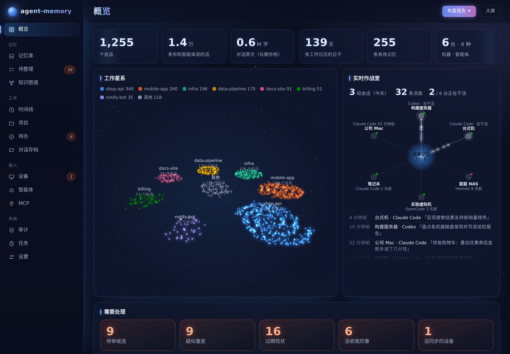
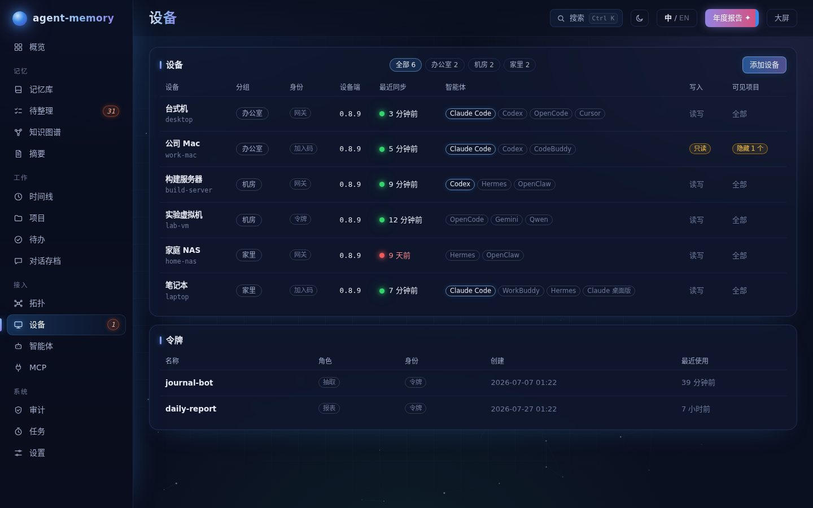
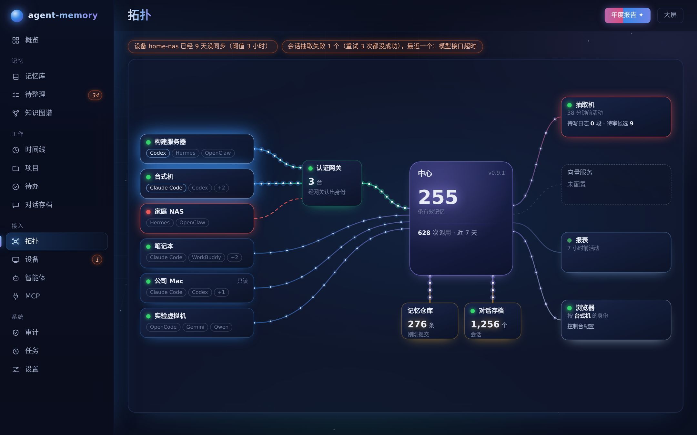

# agent-memory

**One shared memory for every AI coding agent on every machine you own — and a diary of what you did each day.**

[中文](README.md)



You use Claude Code on the desktop, Codex on the laptop, Hermes / OpenClaw on a server, WorkBuddy now and then… each agent remembers on its own, and switching tools or machines means starting from zero. agent-memory is a small self-hosted service that ties them together:

- **Shared memory** — each agent's native memory files (Claude Code memory, Hermes `USER.md`, WorkBuddy `MEMORY.md`, …) sync to a hub; every agent can query and write through MCP tools; a digest (preferences, project status, what you've been doing lately) is injected into each tool's instruction file.
- **Conversation archive + work journal** — every agent's conversations (user and assistant text only, secrets redacted) are uploaded incrementally and kept long-term; a cheap model writes one line per session per day ("what got done"). Ask any agent on any machine "what did I do last Thursday?" or "when did we ship that deploy?".
- **Console** — open the hub in a browser and you get one sidebar console (`/console`): an overview (a rotating "work galaxy", a live war room, things that need attention); a memory library (search, filter, edit, retire), a triage queue (candidates, likely duplicates, stale status) and a knowledge graph; a timeline (work calendar, per-day swimlanes for every machine and agent, punch card, milestones), projects, todos and a searchable conversation archive; a live topology (devices, gateway, hub, storage, worker, with read/write traffic and event pulses, filterable by project), devices (read-only, hidden projects, join codes), agent status and MCP (tool switches and call counts); audit, job status and settings. There is also an auto-cruising wall display (`/wall`, with the live topology as one of its scenes) and a year-in-review (`/w`).
- **Zero dependencies** — hub and device agent are single Node.js files (Node ≥ 18), no database; data is a git repo with one markdown file per memory.

| | | |
|---|---|---|
| [](docs/screenshots/timeline.jpg) | [](docs/screenshots/projects.jpg) | [](docs/screenshots/memory.jpg) |
| Timeline: work calendar and per-day swimlanes | Projects: river chart and machine → agent → project flow | Memory library: filter, search, details on the right |
| [](docs/screenshots/devices.jpg) | [](docs/screenshots/mcp.jpg) | [](docs/screenshots/wall.jpg) |
| Devices: sync status, read-only, hidden projects | MCP: tool switches and 7-day call counts | Wall display: auto-cruising, for a screen on the wall |

> Screenshots use the fictional data from `scripts/demo-data.mjs`.

> The author runs it daily across 8 machines and 7 agents. Code favors "works and easy to change"; comments are in Chinese.

## Supported agents

Claude Code, Codex, WorkBuddy / WorkBuddy AI, CodeBuddy, Hermes, OpenClaw, OpenCode, Gemini CLI, Qwen Code (memory sync and/or conversation capture), plus Cursor, Windsurf and Claude Desktop (MCP only). `setup` detects what's installed and wires it up; MCP servers you disabled stay disabled.

## MCP tools

- Memory: `memory_search` (keyword + semantic), `memory_get`, `memory_remember`, `memory_update`, `memory_retire`, `memory_recent`, `memory_digest`
- Timeline: `memory_timeline`, `conversation_search`, `conversation_get`
- Handoff: `memory_handoff` (a ready-to-paste briefing for a project), `memory_todos` (unfinished work), `memory_entities` (relations between projects, machines, sites, versions)
- Cards (optional read-only long docs): `kb_map`, `kb_search`, `kb_sections`, `kb_read`

## Layout


[](docs/screenshots/topology.jpg)

<sub>The live topology in the console: on a device link, cyan dots are writes and amber dots are reads (density and thickness follow the last 24 hours); each device shows its read/write counts and a 24-cell heartbeat bar, and every new event in the strip below sends a pulse along its link; stale ones turn red, and components that are not configured are drawn dashed.</sub>

```
agent/kb-agent.mjs   device agent: sync memory, upload conversations, write digests, stdio MCP proxy, self-update
hub/                 hub: server.mjs (HTTP + MCP), convlog (archive/journal), extras (handoff/todos/graph/semantic…), admin.mjs (console admin API under /console/api), console.html + console*.css/js (console), wall.html (wall display), wrapped.html (year in review)
worker/              journal.mjs / extract.mjs — run nightly on any machine with Codex CLI
gateway/am-gate.py   optional identity gateway (Tailscale names / libvirt VM names → zero-touch enrollment)
gateway/am-embed.py  optional local embedding service (fastembed + bge-small-zh) for semantic search
deploy/, scripts/    systemd examples, daily/weekly report script
```

## Try it with demo data

No devices needed: generate a fictional demo data set and look around the console.

```bash
node scripts/demo-data.mjs /tmp/am-demo          # creates the data dir and config.json (dir must not exist or be empty)
AGENT_MEMORY_CONFIG=/tmp/am-demo/config.json node hub/server.mjs
# open http://127.0.0.1:8790/ in a browser
```

## Quick start

```bash
sudo mkdir -p /srv/agent-memory/{app,repo,state,archive} && sudo chown -R $USER /srv/agent-memory
cp hub/* agent/kb-agent.mjs /srv/agent-memory/app/
cp config.example.json /srv/agent-memory/config.json
touch /srv/agent-memory/archive/.am-archive
export AGENT_MEMORY_CONFIG=/srv/agent-memory/config.json
node /srv/agent-memory/app/server.mjs join-code 7     # valid for 7 days (0 = no expiry); prints one-line installers for macOS/Linux and Windows
node /srv/agent-memory/app/server.mjs                 # or deploy/agent-memory.service
```

Open `http://<hub>:8790/` for the console (`/wall` for the wall display). The console and wall are only served to machines the identity gateway recognises; the old `/browse`, `/browse/viz`, `/browse/manage`, `/b`, `/v`, `/r` URLs redirect to the matching console page. Without a gateway (local development, a trusted LAN) set `"console_viewer": "<device name>"` in `config.json` and every unidentified browser is treated as that device. **Risk:** anyone who can reach the port can read all memories and conversation summaries, so only use it on a private address and never in production.

Run the printed installer on each machine. For the work journal, create an extractor token (`server.mjs add-device journal-bot extractor`), write `~/.config/agent-memory/extractor.json` on a machine with Codex CLI and enable the timers in `worker/systemd/`. Use a cheap model for these batch jobs.

## Security

Secrets (private keys, API keys, JWTs, password assignments, high-entropy strings) are rejected or redacted before storage; tokens are stored as sha256; per-device read-only and hidden projects; every read/write is logged and shown on the console's audit page. Everything stays on your machines except the conversation snippets sent to the model you configure for journaling.

## License

MIT
