# agent-memory

**让你所有机器上的所有 AI 编程智能体共用一份记忆，并且记得你哪天干了什么。**

[English](README.en.md)

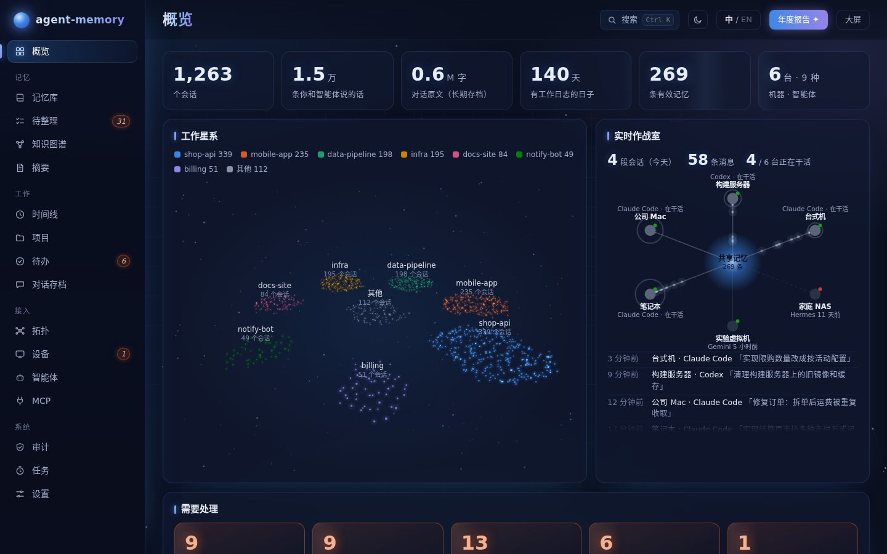

你在台式机上用 Claude Code、笔记本上用 Codex、服务器上跑着 Hermes / OpenClaw、偶尔开 WorkBuddy……每个智能体各记各的，换个工具、换台机器就什么都不知道了。agent-memory 是一个自己部署的小服务，把它们接到一起：

- **共享记忆**：各智能体自带的记忆文件（Claude Code 的 memory、Hermes 的 USER.md、WorkBuddy 的 MEMORY.md…）自动同步到中心；任何智能体都能通过 MCP 工具查、写；每个工具的指令文件里自动放一份摘要（偏好、项目现状、最近在做什么）。
- **对话存档 + 工作日志**：所有智能体的对话（只留你和助手说的话，密钥自动打码）增量上传、长期存档；每天用一个便宜的模型给每个会话写一句"这天做了什么"。任何机器上问"上周四干了什么""那个部署是哪天做的"都能答。
- **控制台**：浏览器打开中心地址就是控制台（`/console`），一个侧栏管全部——概览（旋转的"工作星系"、实时作战室、需要处理的事）；记忆库（搜索、筛选、编辑、作废、修改历史）、待整理（待审候选、疑似重复、过期现状、记忆缺口、冷记忆）、知识图谱、摘要（预览每个智能体启动时拿到的摘要，置顶或排除条目）；时间线（工作日历、当天各机器各智能体的泳道、作息、大事记）、项目（可生成只读分享链接）、待办、对话存档（搜原话、读原文、选一段存成记忆）；拓扑（设备、网关、中心、存储、抽取机的实时连线图，带读写流量和事件脉冲，可按项目筛选、按组折叠，拖时间轴回放近 24 小时）、设备（只读、隐藏项目、分组、加入码）、智能体状态、MCP（工具开关、调用量、耗时和失败率）；审计、任务状态、设置。`Ctrl/Cmd+K` 全局搜索，还能"问我的记忆"。深色和浅色两套主题，中文和英文两种界面。另有自动巡航的大屏（`/wall`，其中一屏是实时拓扑）和年度报告（`/w`）。
- **零依赖**：中心和设备端都是单个 Node.js 文件（Node ≥ 18），不需要数据库；数据是 git 仓库里一条一个 markdown 文件，随时能看、能备份、能回滚。

| | | |
|---|---|---|
| [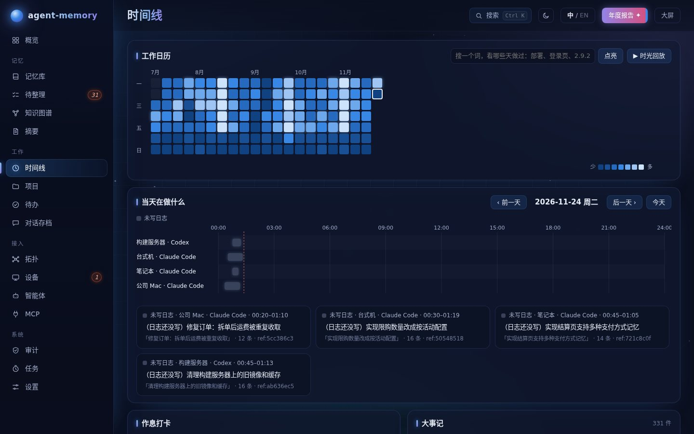](docs/screenshots/timeline.jpg) | [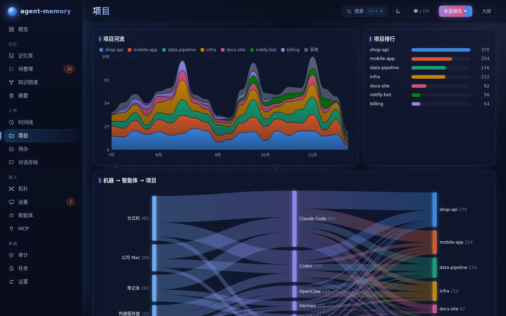](docs/screenshots/projects.jpg) | [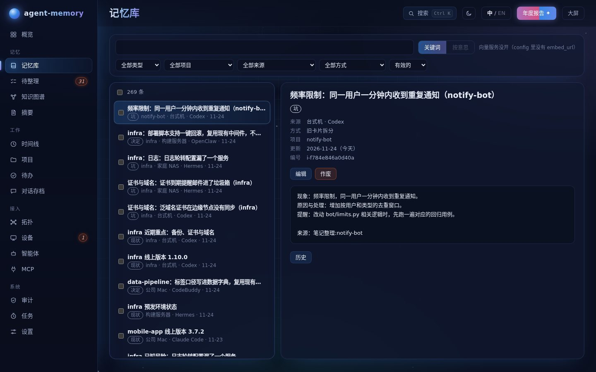](docs/screenshots/memory.jpg) |
| 时间线：工作日历和当天各机器的泳道 | 项目：河流图和机器到智能体到项目的流向 | 记忆库：筛选、搜索，右边看详情和历史 |
| [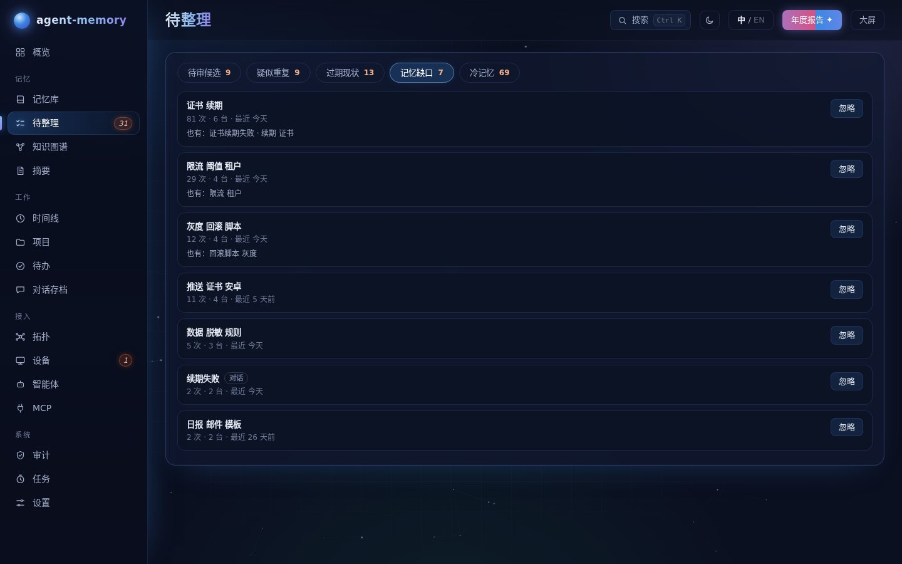](docs/screenshots/triage.jpg) | [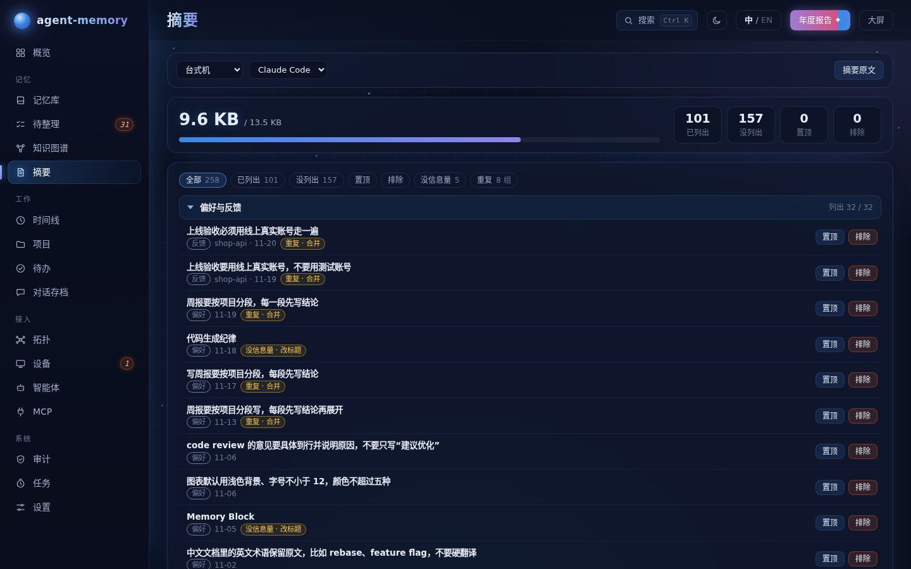](docs/screenshots/digest.jpg) | [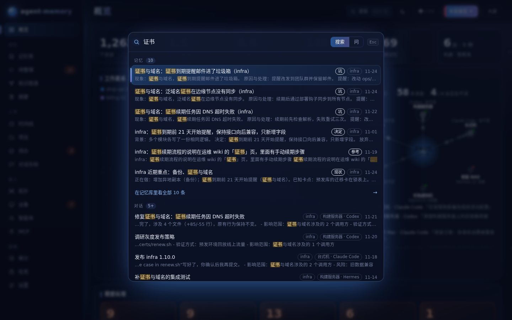](docs/screenshots/search.jpg) |
| 待整理：记忆缺口（搜了没搜到的）和冷记忆 | 摘要：预算用量、置顶和排除、没信息量和重复的标记 | `Ctrl+K`：同时搜记忆、对话、项目、设备、页面，也能问 |
| [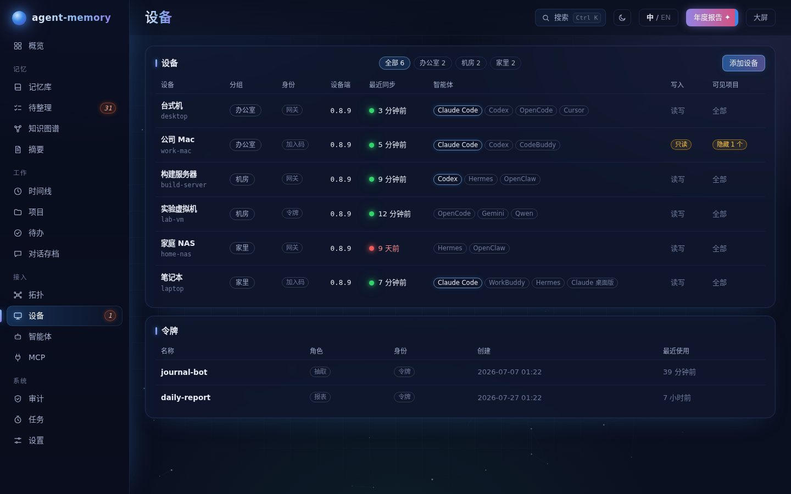](docs/screenshots/devices.jpg) | [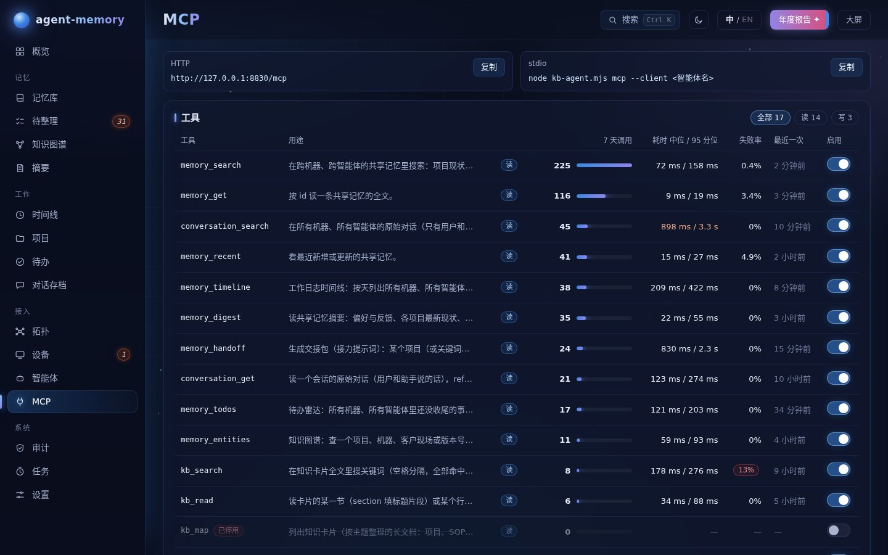](docs/screenshots/mcp.jpg) | [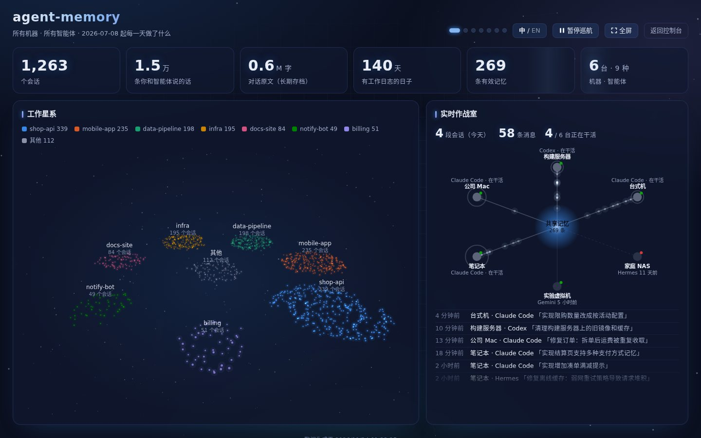](docs/screenshots/wall.jpg) |
| 设备：分组、同步状态、只读、隐藏项目 | MCP：工具开关、7 天调用量、耗时和失败率 | 大屏：自动巡航，适合挂在墙上 |
| [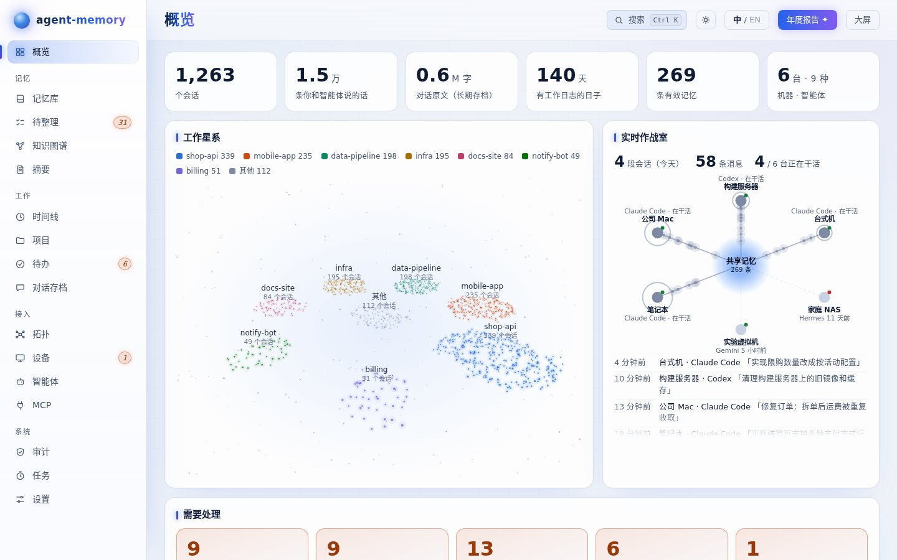](docs/screenshots/overview-light.jpg) | [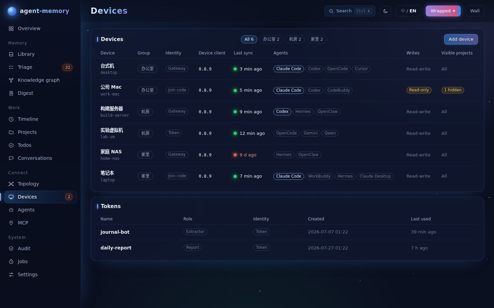](docs/screenshots/devices-en.jpg) | [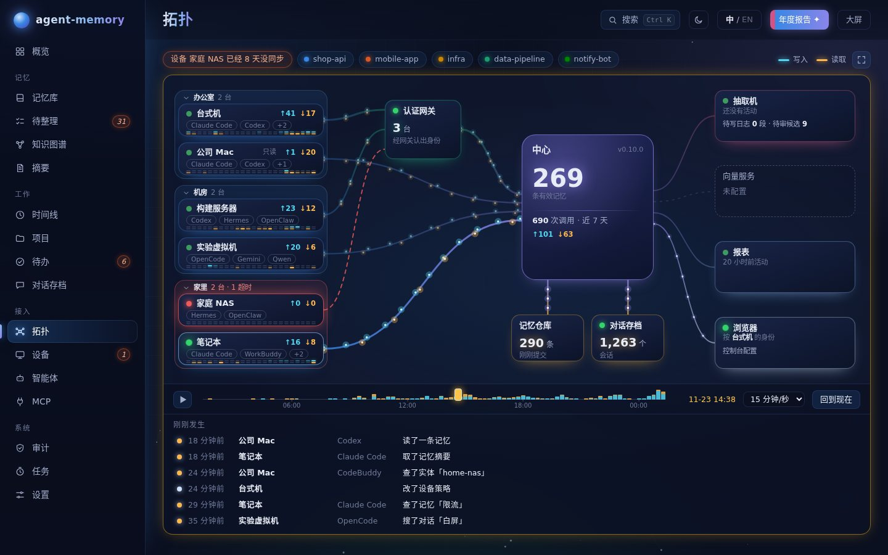](docs/screenshots/topology-replay.jpg) |
| 浅色主题（默认跟随系统） | 英文界面（顶栏 `中 / EN`） | 拓扑回放：拖时间轴看那一刻的连线和事件 |

> 截图用的是 `scripts/demo-data.mjs` 生成的虚构数据。

> 作者自己每天在 8 台机器、7 种智能体上用。代码以"能用、好改"为先，注释是中文。

## 控制台里值得知道的

- **全局搜索和问答**：任意页面按 `Ctrl+K`（Mac `⌘K`）搜记忆、对话、项目、设备、页面；Tab 切到"问"，从记忆和对话里检索，调一个 OpenAI 兼容的对话接口生成答案，答案里的 `[1]` 点了跳到记忆或对话原文。到「设置 → 问答」填 `ask_url`（`…/v1` 或完整的 `…/chat/completions`）、`ask_model`、`ask_key`；密钥只写不读；没配置时"问"显示"未配置"。每人每分钟最多问 10 次，每次提问记审计 `console:ask`（问题前 80 字）。发给模型的对话片段会先打码。
- **用量洞察**：调用记录带命中数、耗时和是否出错。待整理里的"记忆缺口"列出近 30 天搜了但没搜到的查询（同义写法自动归并，可忽略），"冷记忆"列出很久没被读到的有效记忆（写明从哪天起算；数据不足时只提示还在攒）。MCP 页每个工具有近 7 天的中位耗时、95 分位耗时和失败率。
- **记忆工具**：记忆详情里的"历史"列出每一版的时间、改动者和差异，可以恢复到任意一版（恢复会新增一个版本，原生同步来的记忆除外）。对话存档里选中一段，点"存成记忆"，会带着"出处：对话 ref · 日期"存进记忆库。"摘要"页可以置顶或排除条目（`state/digest-rules.json`），并标出没信息量和重复的标题。
- **访问控制和分享**：设备设了 `hide_projects` 后，这台设备打开控制台和 `/browse/*` 时，被隐藏项目的记忆、日志、对话、待办、项目名一律不出现，总数按看得到的重算，它也不能在控制台里改任何设备的隐藏列表。项目页可以把某个项目的时间线或交接包生成只读链接 `/s/<令牌>`（1、7 或 30 天有效，可随时作废，只含工作日志摘要、不含对话原文，令牌只存哈希，详见 [docs/share-links.md](docs/share-links.md)）。链接仍然只在你的内网里能打开；要对外就得另放一个只转发 `/s/` 的反向代理。
- **主题和语言**：顶栏的图标在"跟随系统 / 浅色 / 深色"之间循环，`中 / EN` 切换界面语言（都记在浏览器里）。英文由浏览器里的翻译器完成，**服务端接口返回的错误原文仍是中文**；你自己的数据不翻译。大屏、年报、审批页保持深色。
- **打开更快**：静态文件和 1KB 以上的接口响应按 `Accept-Encoding` 压缩；控制台的样式、脚本在服务端合并成带内容哈希的包（长期缓存），首屏数据一次取齐，打开拓扑页只要 html 之外的三个请求。

## 能接哪些智能体

设备端 `setup` 自动识别本机装了什么，自动接上（你手动停用过的插件保持停用）：

| 智能体 | 同步它自己的记忆 | 给它的 | 收它的对话 |
|---|---|---|---|
| Claude Code | `~/.claude/projects/*/memory/*.md` | CLAUDE.md 摘要块 + MCP | ✓ |
| Codex | —（夜里从会话里抽候选记忆） | AGENTS.md 摘要块 + MCP | ✓（跳过 `codex exec` 批处理） |
| WorkBuddy / WorkBuddy AI | MEMORY.md（含 `user-*-personal/`） | USER.md 用法说明 + MCP | ✓ |
| CodeBuddy | `memery/*_memery.md` | MCP | ✓ |
| Hermes | `USER.md` / `MEMORY.md`（按 § 分段） | MCP（自动 `hermes mcp add`） | ✓（`state.db`） |
| OpenClaw | 工作区 `USER.md` / `MEMORY.md` / 日记 | AGENTS.md 用法 + MCP | ✓ |
| OpenCode / Gemini CLI / Qwen Code | — | 摘要块 + MCP | ✓ |
| Cursor / Windsurf / Claude 桌面版 | — | MCP | — |

## 工具（MCP，所有智能体通用）

- 记忆：`memory_search`（关键词 + 按意思）、`memory_get`、`memory_remember`、`memory_update`、`memory_retire`、`memory_recent`、`memory_digest`
- 时间线：`memory_timeline`（按天列出所有机器所有智能体的工作日志）、`conversation_search`（搜原话）、`conversation_get`（读原文）
- 接力：`memory_handoff`（某个项目的交接包，直接贴给新会话）、`memory_todos`（还没收尾的事）、`memory_entities`（项目/机器/客户现场/版本的关系）
- 卡片（可选的只读长文档）：`kb_map`、`kb_search`、`kb_sections`、`kb_read`

不支持 MCP 的场合用命令行：`node ~/.agent-memory/kb-agent.mjs search|timeline|handoff|todos|entity …`。

## 组成


[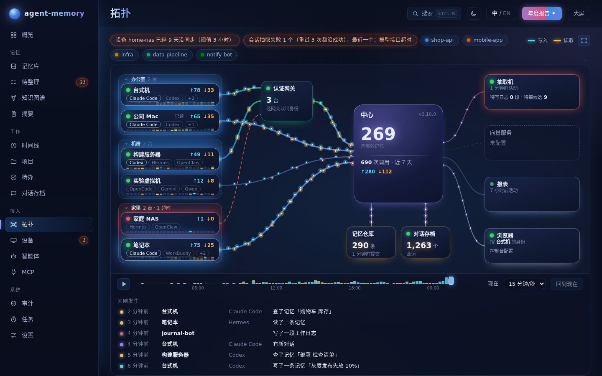](docs/screenshots/topology.jpg)

<sub>控制台里的实时拓扑：设备连线上青色光点是写入、琥珀色光点是读取，密度和粗细按近 24 小时的量走；设备上有读写数字和上写下读的 24 格心跳条，下方事件带每来一条新事件，连线上就跑过一道脉冲；画布和事件带之间的时间轴可以拖到近 24 小时的任意时刻回放；同组设备共用一块底板，可以折叠成一个汇总节点；超时的变红，没配置的组件画成虚线。</sub>

```
agent/kb-agent.mjs     设备端（每台机器一份）：同步记忆、上传对话、写摘要、stdio MCP 代理、自动升级
hub/                   中心：server.mjs（HTTP + MCP）、convlog（对话存档/日志）、extras（交接包/待办/图谱/语义搜索…）
                       admin.mjs 控制台管理接口（/console/api）、console.html + console*.css + console-*.js 控制台（外壳在 console-core.js）、wall.html 巡航大屏、wrapped.html 年报
worker/                抽取机（任意一台能跑 codex 的机器）：journal.mjs 写工作日志、extract.mjs 抽候选记忆
gateway/am-gate.py     可选：认证网关，按 Tailscale 机器名 / libvirt 虚拟机名认出调用方，实现"一条命令接入、自动登记"
gateway/am-embed.py    可选：本地向量服务（fastembed + bge-small-zh），给"按意思搜"用
deploy/                systemd 单元示例
scripts/report.py      日报/周报：打印成文本，交给你的定时任务推到 IM
```

## 先看看长什么样

不接任何设备，生成一套虚构的演示数据就能看到控制台：

```bash
node scripts/demo-data.mjs /tmp/am-demo          # 生成数据目录和 config.json（目录必须不存在或为空）
AGENT_MEMORY_CONFIG=/tmp/am-demo/config.json node hub/server.mjs
# 浏览器打开 http://127.0.0.1:8790/
```

## Docker 一键启动

镜像只带中心（`hub/`，加上加入码安装用的设备端脚本），基于 `node:20-alpine`，非 root 运行，端口 8790；配置、仓库、状态、对话存档都在卷 `/data`。

**演示**（虚构数据，不用接设备）：

```bash
docker compose --profile demo up        # 首次会构建镜像并生成演示数据，然后打开 http://127.0.0.1:8790/
docker compose --profile demo down -v   # 清理，连演示数据一起删
```

演示模式没有认证（靠 `console_viewer`），端口固定只绑 `127.0.0.1`。**不要改成对外地址，不要放到公网。**

**正式**：

```bash
export AM_PUBLIC_URL=http://hub.example:8790       # 设备访问中心用的地址
docker compose --profile hub up -d                 # 数据在卷 am-data，首次启动在卷里生成 /data/config.json
docker compose exec hub node hub/server.mjs add-device my-laptop   # 打印设备令牌；一次接多台用 join-code 7
```

- 控制台要认出身份才能打开：前面放认证网关（`gateway/am-gate.py`，启动前设 `AM_GATE_SECRET` 和网关一致），或在 `/data/config.json` 里写 `"console_viewer": "my-laptop"` 再 `docker compose restart hub`（只在不对外的地址上用）。
- `AM_PUBLIC_URL`、`AM_GATE_SECRET`、`AM_CONSOLE_VIEWER` 只在首次生成配置时读，之后用 `docker compose exec hub vi /data/config.json` 改；带自己的配置时，路径要指向 `/data/…`，`listen` 写 `0.0.0.0`。
- `AM_PORT` 改宿主机端口，`AM_BIND` 改监听地址（默认 `0.0.0.0`）；用宿主机目录代替卷时，目录要归 uid 1000。

## 快速开始

**1. 起中心**（任意一台 Linux，Node ≥ 18、git）：

```bash
sudo mkdir -p /srv/agent-memory/{app,repo,state,archive} && sudo chown -R $USER /srv/agent-memory
cp hub/* agent/kb-agent.mjs /srv/agent-memory/app/
cp config.example.json /srv/agent-memory/config.json    # 改 public_url 等
touch /srv/agent-memory/archive/.am-archive              # 对话存档目录的标记（建议这个目录放机械盘）
export AGENT_MEMORY_CONFIG=/srv/agent-memory/config.json
node /srv/agent-memory/app/server.mjs add-device my-laptop     # 打印一个设备令牌
node /srv/agent-memory/app/server.mjs                          # 或用 deploy/agent-memory.service
```

**2. 接设备**：最简单是生成加入码，在每台机器上粘一行：

```bash
node /srv/agent-memory/app/server.mjs join-code 7    # 7 天内可用来加机器（join-code 0 长期有效），打印 macOS/Linux 和 Windows 的安装命令
```

安装脚本会：没有 Node 就从中心下载一份（把 Node 安装包放进 `dist_dir`）→ 用主机名登记 → `setup` 识别并接上本机的智能体 → 装每 10 分钟一次的定时任务（Windows 计划任务 / launchd / systemd 用户定时器）→ 首次同步。

想要"连加入码都不用"：在中心宿主机上跑 `gateway/am-gate.py`（Tailscale 网络里的机器和本机的 libvirt 虚拟机会被自动认出、自动登记），然后各机器用固定命令 `curl -fsSL http://<中心>:3190/install.sh | bash`（Windows：`irm http://<中心>:3190/install.ps1 | iex`）。`auto_register_deny` 里写不该接入的机器名。

**3. 工作日志**（可选但推荐）：在一台装了 [Codex CLI](https://github.com/openai/codex) 的机器上，用 `server.mjs add-device journal-bot extractor` 生成抽取令牌，写 `~/.config/agent-memory/extractor.json`（见 `worker/extract.mjs` 开头），装上 `worker/systemd/` 里的定时器。模型、推理强度在 extractor.json 里配，**批量任务建议用便宜的模型**。

**4. 按意思搜**（可选）：`pip install fastembed`，跑 `gateway/am-embed.py`，在中心配置里写 `embed_url`。不开也不影响关键词搜索。

打开 `http://<中心>:8790/`（或经网关的 3190）就是控制台，`/wall` 是大屏。控制台、大屏只对已经接入、且能被网关认出身份的机器开放。旧地址 `/browse`、`/browse/viz`、`/browse/manage`、`/b`、`/v`、`/r` 会自动跳到控制台对应页面。

没有网关的环境（本机开发、可信内网）可以在 `config.json` 里写 `"console_viewer": "<设备名>"`：认不出身份的浏览器一律按这台设备算。**风险**：能连到这个端口的人就能看到全部记忆和对话摘要，只在不对外的地址上用，生产环境不要配。

## 安全和隐私

- 写入前拦截私钥、各类 API Key/令牌、JWT、口令赋值、高熵串；原生记忆和对话里的疑似密钥打码后再存。
- 令牌只存 sha256；角色分 device / extractor / reporter / admin。可以给某台机器设只读、隐藏某些项目、分组（`server.mjs device-set <设备> readonly=true hide_projects=a,b group=办公室`）。隐藏项目对控制台和 MCP 的 `memory_search` / `memory_get` 生效；MCP 的其余工具和设备端 `/v1/*` 接口目前不按它过滤，别把它当成强隔离。
- 审计：每次查询/写入都记在 `state/usage.jsonl`，控制台有审计页。
- 数据全在你自己的机器上；只有工作日志/抽取那一步，以及你配置了"问我的记忆"时被检索到的片段（打码后），会发给你配置的模型。

## 配置项（config.json）

见 [config.example.json](config.example.json)。常用：`public_url`、`archive_dir`、`gate_secret`（和网关一致）、`auto_register_deny`、`embed_url`、`device_labels`（控制台和大屏上的设备显示名）、`graph_entities`（知识图谱里要认的机器名、客户现场名）、`digest_budget`、`auto_approve_days`、`console_viewer`（见上，默认不配）、`ask_url` / `ask_model` / `ask_key`（"问我的记忆"用的 OpenAI 兼容接口，密钥只写不读）。

## 许可证

MIT
